# Research Methodology: Adaptive ML-DST Streaming Intrusion Detection

## 1. System Overview

The Adaptive ML-DST system is designed for continuous, streaming network intrusion detection in cloud computing environments. The pipeline processes precomputed bidirectional network flow statistics (e.g., CICIDS2017 feature representation) arriving in chronological order. 

The system operates under a **prequential (predict-before-update)** evaluation paradigm with **delayed label feedback**:
1. When a batch of network flows arrives at time $t$, the system predicts attack scores and binary alerts using its current model parameters $\theta_{t-1}$.
2. The predictions and uncalibrated decision scores are logged immediately before any model state changes occur.
3. True ground-truth labels for batch $t - D$ (where $D \ge 1$ is the feedback delay parameter) are released to the model for incremental learning (`partial_fit`).

---

## 2. Standard Algorithms vs. Custom Components

To maintain scientific integrity and avoid overclaiming:

| Component | Nature | Description |
| :--- | :--- | :--- |
| **Primary Streaming Detector** | **Standard** | Online Stochastic Gradient Descent (SGD) logistic regression (`SGDClassifier(loss='log_loss', penalty='l2', alpha=1e-4)`). Updates weights incrementally via mini-batch convex optimization. It is an industry-standard linear classifier, **not a novel algorithm**. |
| **Feature Preprocessing** | **Standard** | `RobustScaler` (median and interquartile range scaling) and median imputation fitted strictly on initial training data. Handles missing/infinite values deterministically. |
| **Anomaly Evidence Detector** | **Standard** | `HalfSpaceTrees` streaming anomaly detector (via `river`) fit on benign baseline traffic, generating continuous anomaly scores in $[0, 1]$. |
| **Evidence Fusion Engine** | **Adapted** | Dempster-Shafer Theory (DST) combination rule combining classifier belief, anomaly evidence, and temporal deviation into a composite attack belief $m(\text{Attack})$ and uncertainty $m(\Theta)$. Adapted from baseline cloud IDS literature (Al-Omari et al., 2023). |
| **Streaming Pipeline Core** | **Newly Implemented** | Strict chronological multi-day capture replay, predict-before-update logging, bounded delayed-feedback queues, independent parallel model evaluators, and persistent JSONL streaming serialization. |
| **Frozen Inference Engine** | **Newly Implemented** | Standalone production predictor (`OnlineSGDPredictor`) decoupling inference from training, enforcing schema validation, zero weight updates during prediction, and REST API integration. |
| **Blockchain Audit Ledger** | **Adapted / Implemented** | Solidity smart contract (`RiskAuditLedger.sol`) and Python adapter for cryptographically verifiable, append-only logging of drift alerts and defense mitigations. |

---

## 3. Workflow & Lifecycle Phases

```mermaid
flowchart LR
    A[Raw Flow CSVs] --> B[Monday Baseline Split]
    B --> C[Fit Scaler & Imputer]
    C --> D[Initial SGD Fit]
    D --> E[Export Initial Checkpoint]
    E --> F[Chronological Stream Replay]
    F --> G[Predict Batch t]
    G --> H[Log Predictions]
    H --> I[Queue Feedback t]
    I --> J[Release Labels t-D]
    J --> K[Partial Fit SGD]
    K --> L[Export Final Checkpoint]
```

### Phase 1: Clean Warm-Up & Initialization (Monday)
- **Dataset Partition**: Monday capture consisting solely of benign baseline network flows (8,445 samples).
- **Preprocessing Fit**: The `RobustScaler` and feature median imputation dictionaries are fitted strictly on this warm-up data. Future streaming data is transformed using these frozen statistics to prevent look-ahead contamination.
- **Initial Checkpoint**: The primary SGD classifier is initialized with `partial_fit` on this baseline with all known classes `[0, 1]`.
- **Export**: Saved to `models/online_sgd_initial.joblib`.

### Phase 2: Calibration & Thresholding
- Standard baseline decision threshold is set to $\tau = 0.50$.
- No evaluation labels from future days (Tuesday through Friday) are used to tune or optimize the threshold.
- Attack score values from SGD are computed via sigmoid-transformed decision function:
  $$\hat{p} = \sigma(w^T x + b) = \frac{1}{1 + e^{-(w^T x + b)}}$$
  *(Note: Unless explicitly calibrated via Platt scaling or Isotonic regression, this value represents an uncalibrated monotonic ranking score, not a frequentist probability).*

### Phase 3: Chronological Stream Evaluation (Tuesday–Friday)
- Evaluates 41,555 streaming flows across Tuesday (FTP-Patator, SSH-Patator), Wednesday (DoS/DDoS, Heartbleed), Thursday (Web attacks, Infiltration), and Friday (Botnet, PortScan, DDoS).
- Feedback delay is fixed at $D = 1$ batch (1,000 flows). The model must predict 1,000 flows before receiving the ground truth labels for the preceding 1,000 flows.
- Evaluation metrics are computed strictly on the predictions recorded at time $t$ before `partial_fit` is called.

### Phase 4: Final Online Checkpoint Export
- At the conclusion of the 41,555 streaming flows, the online classifier's adapted state $\theta_{final}$ is exported to `models/online_sgd_final_online.joblib`.
- This checkpoint reflects the cumulative online learning over historical streaming flows.

---

## 4. Experimental Feedback & Rigor Assumptions

1. **Temporal Non-Exchangeability**: Network intrusion flows are non-IID and exhibit strong temporal correlation. Cross-validation or random shuffling invalidates temporal causality and creates severe data leakage. All evaluations in this project strictly enforce chronological order.
2. **Predict-Before-Update**: In online machine learning, evaluating a model on data it has already used for weight updates produces artificially inflated accuracy. We enforce prequential logging before any call to `partial_fit`.
3. **Warm-up Exclusion**: Initialization and warm-up samples are strictly excluded from streaming evaluation metrics to measure true out-of-sample generalization.
4. **Independent Model State**: Each comparative model (Online SGD, Anomaly Detector, ML-DST) maintains independent internal state and thresholding.

---

## 5. Status of Proposed Contributions & Empirical Evidence

| Proposed Contribution | Status | Empirical Evidence / Finding |
| :--- | :--- | :--- |
| **Online SGD Primary Detector** | **Supported** | Achieves 93.56% accuracy, 86.88% attack recall, and 2.66% FPR under realistic $D=1$ delayed feedback. Fast execution ($<0.05$ ms/flow) and minimal memory footprint ($<150$ MB). |
| **DST Multi-Sensor Evidence Fusion** | **Unproven / Negative** | Under standard $\tau=0.50$ thresholding, ML-DST achieved 42.69%–47.25% recall, underperforming the standalone SGD detector (86.88%). Dempster's rule concentrates mass on uncertainty when sensors conflict, requiring extensive threshold recalibration to match raw SGD recall. **DST cannot currently be claimed as an improvement over SGD.** |
| **Drift Detection via ADWIN** | **Partially Supported** | ADWIN successfully detected distribution shifts across multi-day attack transitions (Tuesday SSH/FTP brute force and Friday PortScan). However, resetting or adapting the learning rate upon drift alarm showed minimal impact on final accuracy on this dataset (93.56% vs 93.56%). |
| **Blockchain Audit Trail** | **Demonstrated in Simulation** | Successfully records hashes of drift events and mitigation triggers on a local mock or EVM testnet. Throughput scaling, transaction gas fees, and network latency under multi-gigabit line rates have not been tested. |
| **Hierarchical Risk Propagation** | **Implemented Architecture** | Correctly aggregates node-level flow scores into cluster and cloud-wide risk indices. Physical infrastructure intervention (e.g., dynamic OpenFlow route reconfiguration) remains simulated. |
